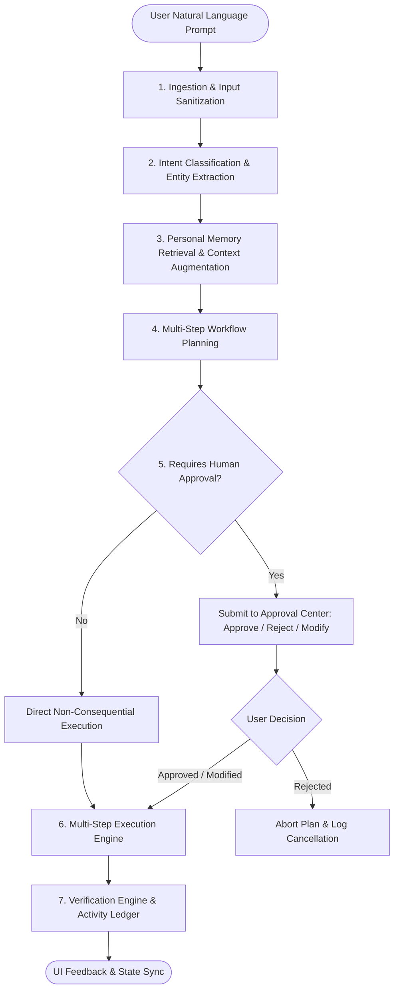
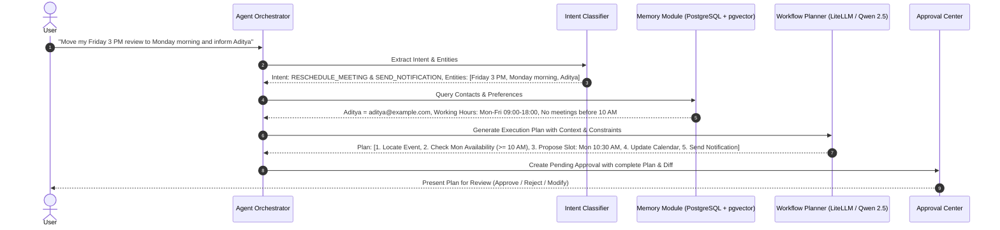
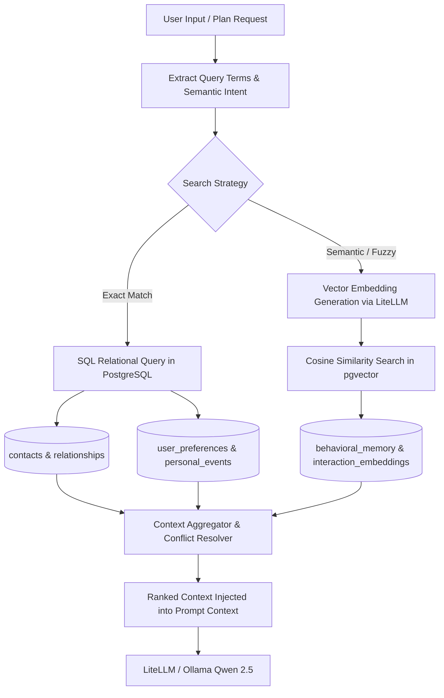
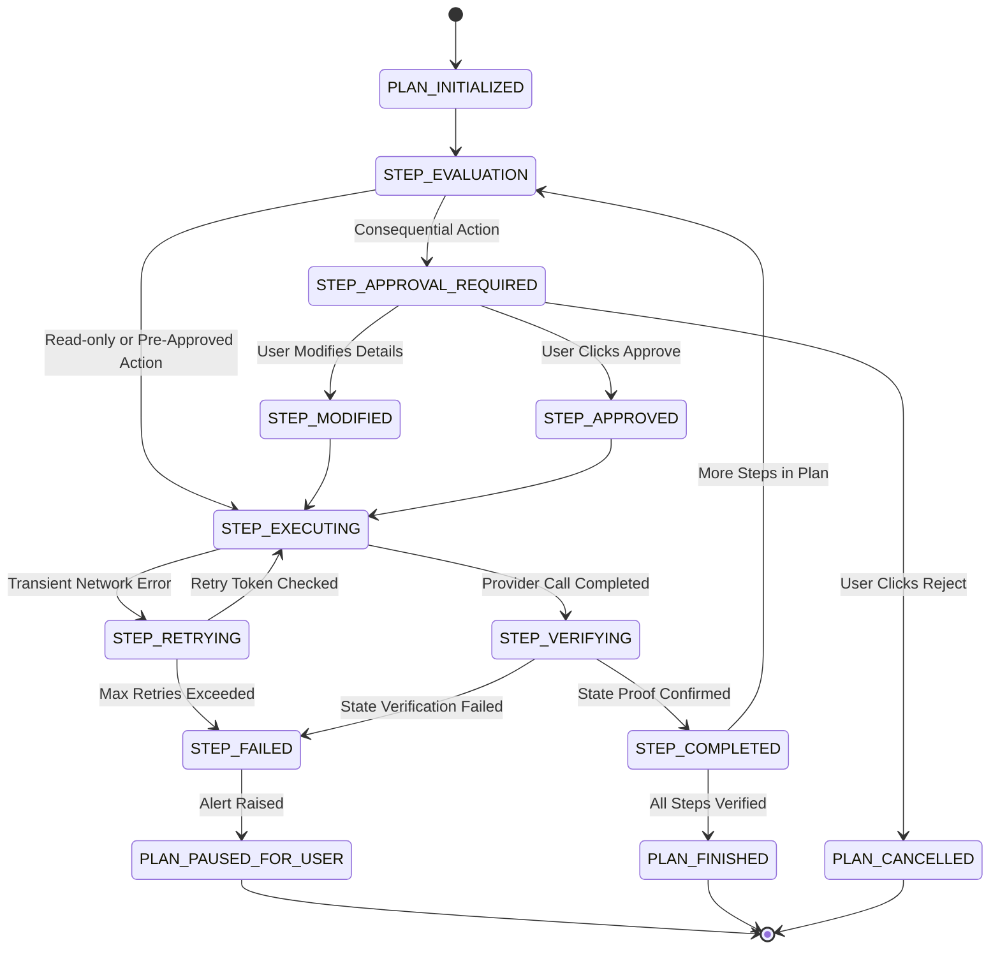

# FLOW — Agent Orchestration Design

**Version:** 1.0  
**Document Type:** Agent Architecture Specification  
**Status:** Approved Architecture  
**Product Category:** Agentic AI Personal Productivity Operating System  

---

## 1. Overview

The Agent Orchestration Layer serves as the intelligence and planning core of FLOW. It bridges natural-language user intentions with structured, deterministic execution workflows while maintaining:
- **Persistent Personal Memory** across contacts, relationships, preferences, events, and behavioral patterns.
- **Human-in-the-Loop Governance** where consequential actions require approval (Approve, Reject, Modify).
- **Post-Execution State Verification** confirming that external services (Microsoft Graph, Gmail, Google Calendar) successfully applied changes.
- **Audit Logging** tracking every prompt, reasoning step, approval decision, and outcome in the Activity Ledger.

The agent never executes consequential operations unilaterally. It creates structured plans, coordinates memory lookups, dispatches approval requests, verifies execution receipts, and updates the user.

---

## 2. Core Agent Pipeline

The agent pipeline processes instructions through seven discrete stages.

### Agent Pipeline Diagram

---

## 3. Planning Workflow

The Planning Engine transforms unstructured prompts into a directed sequence of actionable steps.

### Planning Workflow Diagram

---

## 4. Personal Memory System & Retrieval Flow

FLOW maintains five distinct types of persistent personal memory:
1. **Contact Memory:** Name, email, primary role, department, notes.
2. **Relationship Memory:** Interpersonal and professional associations (e.g., "Aditya = Co-Lead", "Rahul = Client").
3. **Preference Memory:** Work patterns, scheduling rules, preferred communication tone, meeting buffers.
4. **Event Memory:** Milestones, birthdays, anniversaries, project deadlines, exam dates.
5. **Behavioral Memory:** Learned habits, common meeting durations, recurring study times.

### Memory Retrieval Flow Diagram

---

## 5. Multi-Step Execution Flow

Execution involves step-by-step progress, parameter binding, external API invocation, and error isolation.

### Multi-Step Execution Flow Diagram

---

## 6. Proactive Intelligence Integration

The agent does not simply wait for user commands. A background Proactive Intelligence Layer evaluates productivity health and triggers agent plans:
- **Deadline Risk Detection:** Scans task deadlines against current time and scheduled calendar blocks.
- **Missing Reply Detection:** Tracks sent emails to key contacts that have had no reply after a designated duration.
- **Schedule Health Analysis:** Flags meeting overload, missing lunch buffers, or lack of focus blocks.
- **Conflict Alerting:** Identifies concurrent meetings or overlapping task blocks and prepares rescheduling proposals.

When a proactive condition is identified, the agent creates a proactive recommendation in the Dashboard and queues an approval action for the user to review.
