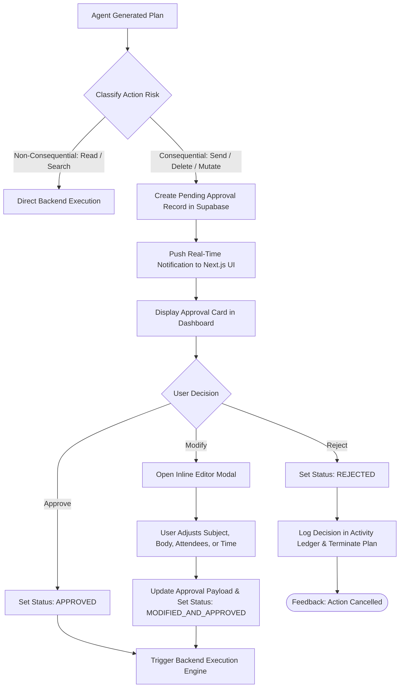
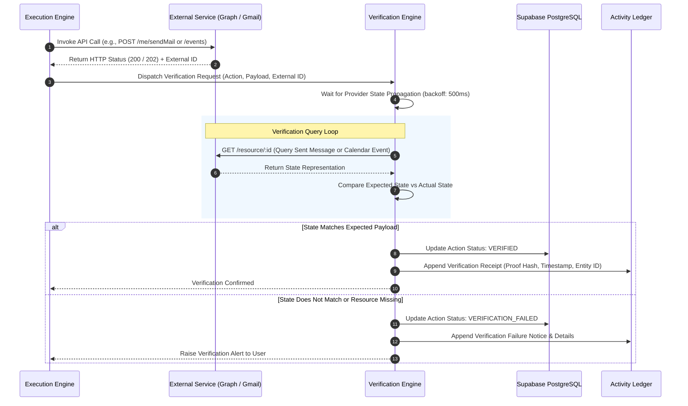
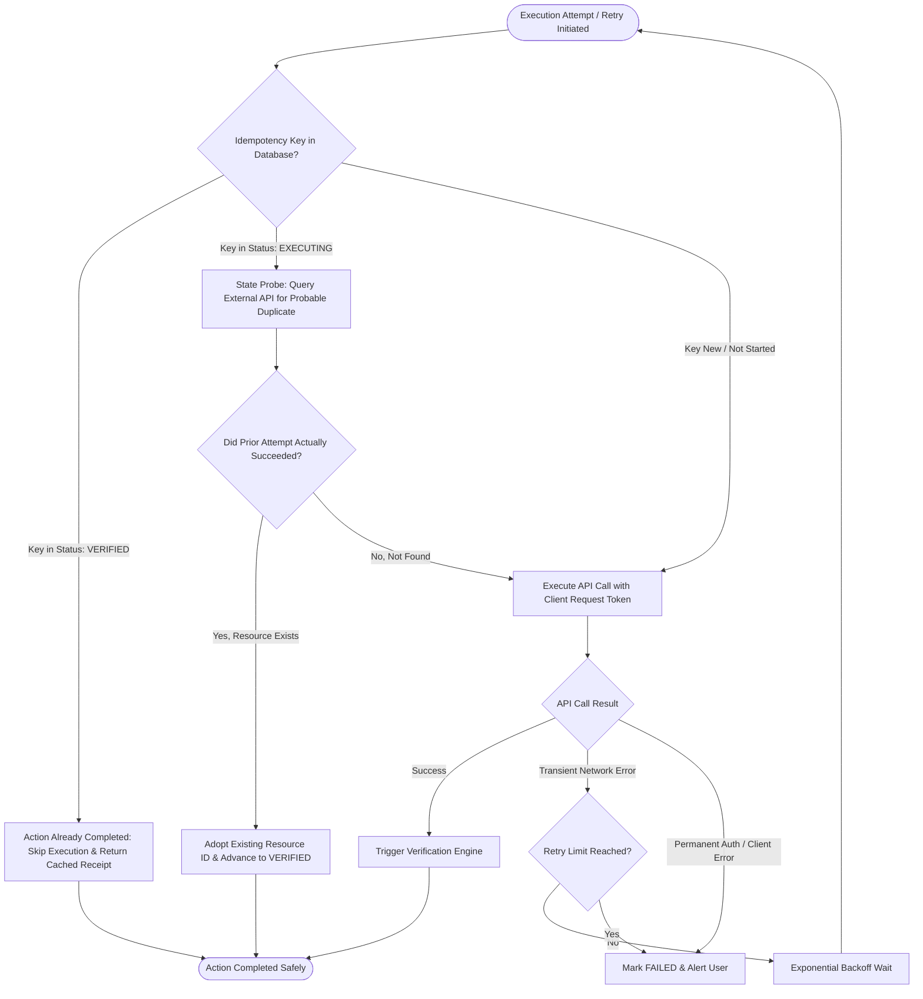

# FLOW — Approval & Verification System

**Version:** 1.0  
**Document Type:** Agent Design Specification  
**Status:** Approved Architecture  
**Module:** Approval Center & Verification Engine  

---

## 1. Overview

The Approval Center and Verification Engine represent the core safety and trust guarantees of FLOW. Together, they ensure that:
1. No consequential or irreversible action occurs without explicit human consent.
2. Users can adjust proposed actions using inline editing before executing them.
3. Every operation executed against external APIs (Microsoft Graph, Gmail, Google Calendar) is actively verified before being marked complete.
4. Retry attempts never duplicate operations.
5. All approvals, execution attempts, and verification receipts are immutably logged in the Activity Ledger.

---

## 2. Approval Center Architecture & Flow

The Approval Center intercepts all agent-planned actions marked as consequential:
- **Email Actions:** Sending an email, sending a reply, modifying drafts.
- **Calendar Actions:** Creating new events, rescheduling existing meetings, deleting appointments, adding attendees.
- **Task Actions:** Deleting tasks, shifting project milestones, altering priorities.

### Approval Flow Diagram

---

## 3. Verification Engine & State Confirmation Flow

The Verification Engine validates that an external system's actual state matches the expected outcome of an action.

### Verification Targets & Checks
1. **Email Verification:**
   - Provider HTTP acknowledgment received (e.g., Microsoft Graph `202 Accepted` or Gmail API `200 OK`).
   - Querying the user's `Sent Items` folder to confirm the message exists with the allocated `message_id`.
   - Matching recipient address and timestamp within acceptable drift window.
2. **Calendar Verification:**
   - Confirming event creation or update by querying the calendar event by `event_id` or `iCalUId`.
   - Verifying that start time, end time, and attendee list reflect the approved values.
   - Confirming that no duplicate event was created.
3. **Task Verification:**
   - Confirming task record insertion or mutation in Supabase and external sync targets (Microsoft To Do).
   - Verifying subtask associations and parent project linking.

### Verification Flow Diagram

---

## 4. Retry Protection & Idempotency Flow

To prevent duplicate emails, double-booked meetings, or multiple task copies during network dropouts or backend retries, FLOW implements strict idempotency safeguards.

### Retry Protection Rules:
1. **Idempotency Token:** Every approved action receives a unique cryptographic `idempotency_key` (UUID v4 + SHA-256 hash of the approved payload).
2. **Pre-Execution Check:** Before calling an external API, FLOW checks if the `idempotency_key` is already associated with an `EXECUTED` or `VERIFIED` record in the database.
3. **State Probing Prior to Retry:** If a network timeout occurs, FLOW does not immediately retry. Instead, it queries the provider using the expected attributes (e.g., search Sent Items by subject and timestamp) to verify whether the previous attempt actually succeeded before retrying.

### Retry Protection Flow Diagram

---

## 5. Activity Ledger Integration

The Activity Ledger provides an append-only audit trail capturing three categories of logs:
1. **Execution Logs:** Exact timestamps, actor, parameters, target service, and raw HTTP response codes.
2. **Verification Logs:** Verification checks performed, retrieved state proof, diff analysis, and validation timestamps.
3. **Approval Logs:** Reviewer ID, decision (Approve, Reject, Modify), modified field diffs, and decision timestamp.

This ensures complete operational transparency, post-incident debugging capability, and judge-verifiable auditability.
