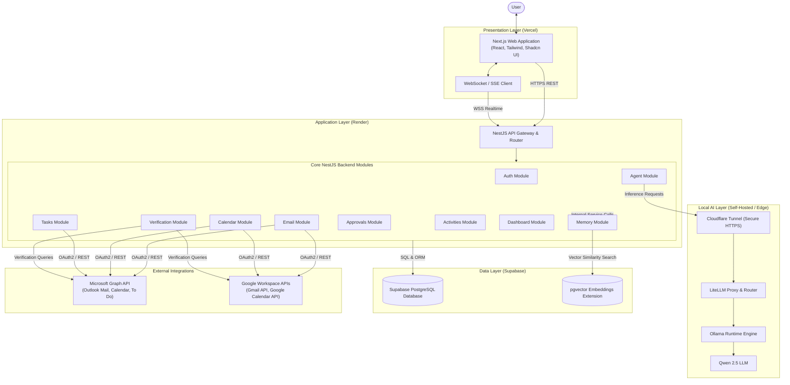
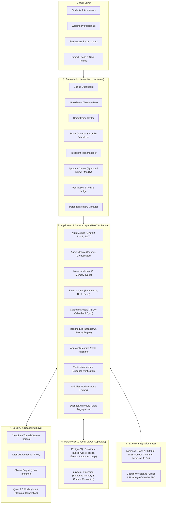
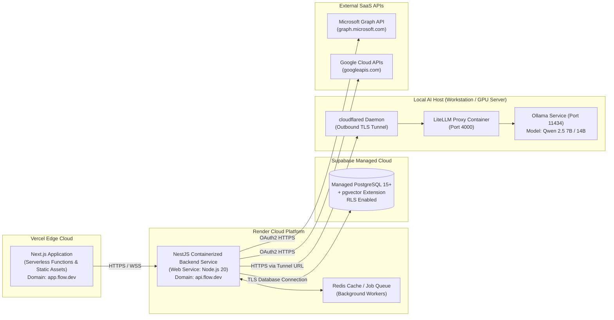
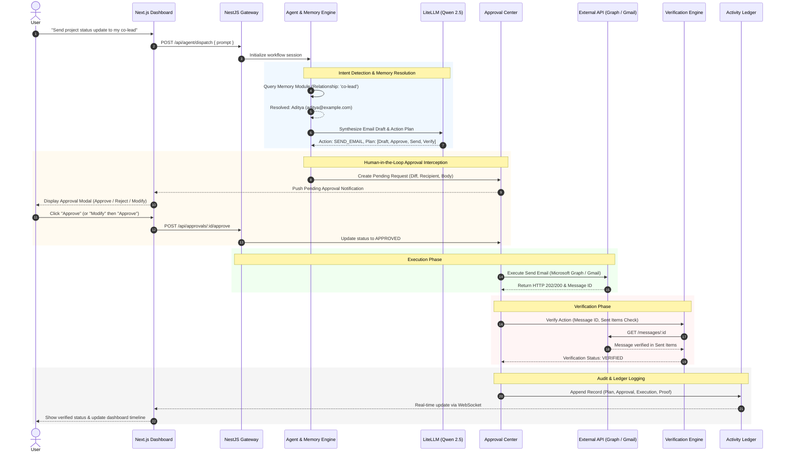

# FLOW — System Architecture Specification

**Version:** 1.0  
**Document Type:** System Architecture Specification  
**Status:** Approved Architecture  
**Product Category:** Agentic AI Personal Productivity Operating System  

---

## 1. Architecture Overview

FLOW is an Agentic AI Personal Productivity Operating System designed to coordinate email, calendar, and task management across modern productivity environments. The architecture bridges conversational agent planning with deterministic, verified execution pipelines.

FLOW adheres strictly to seven core architectural principles:
1. **Human Approval Required:** Consequential external actions (sending emails, deleting tasks, scheduling meetings) require explicit approval before execution.
2. **Verification Before Success:** External API responses are actively verified to ensure the intended state change has truly occurred.
3. **Activity Logging:** Every planning decision, user approval, execution attempt, and verification outcome is written to an append-only audit ledger.
4. **Retry-Safe Execution:** Idempotency keys and state reconciliation protect against duplicate actions during network retries or process restarts.
5. **Persistent User Memory:** Long-term memory stores contacts, relationships, preferences, personal events, and behavioral patterns using relational and vector databases.
6. **Proactive Assistance:** Continuous monitoring detects scheduling conflicts, approaching deadlines, missing email responses, and schedule health risks.
7. **Explainable Actions:** Every proposed action contains explicit reasoning, data references, and expected consequences.

---

## 2. High-Level Architecture

The system is structured across distinct presentation, application, agent reasoning, local AI, persistence, and external integration layers.

### High-Level Architecture Diagram

---

## 3. Layered Architecture

FLOW strictly isolates concerns across six horizontal layers to guarantee modularity, maintainability, and clean boundaries.

### Layered Architecture Diagram

### Detailed Layer Responsibilities

#### 3.1 User Layer
Represents the target personas interacting with FLOW via conversational prompts or dashboard controls.

#### 3.2 Presentation Layer
- Built with **Next.js**, **React**, **Tailwind CSS**, and **Shadcn UI**, hosted on **Vercel**.
- Interacts with backend REST endpoints for transactional mutations and WebSockets for real-time progress streaming and verification alerts.
- Enforces Human-in-the-Loop workflows by displaying pending approvals with Approve, Reject, and Modify controls.

#### 3.3 Application Layer
- Built with **NestJS** and **Node.js**, deployed on **Render**.
- Implements the 10 major backend modules:
  1. `Auth`: Token lifecycle, OAuth2 refresh flows, and session management.
  2. `Agent`: Multi-step workflow planner, tool execution, and prompt construction.
  3. `Memory`: Ingestion, retrieval, and vector search for contacts, relationships, preferences, events, and behavioral patterns.
  4. `Email`: Email reading, drafting, sending, follow-up detection, and email-to-task extraction.
  5. `Calendar`: Native FLOW calendar operations, external vendor synchronization, conflict detection, and focus block creation.
  6. `Tasks`: Quick tasks, project tasks, study plans, event tasks, priority scoring, and AI breakdowns.
  7. `Approvals`: Lifecycle governance for pending approvals (Approve, Reject, Modify).
  8. `Verification`: Verification checks against external APIs to confirm real-world state mutations.
  9. `Activities`: Immutable execution logs, approval logs, and verification receipts.
  10. `Dashboard`: Unified feed aggregation across emails, tasks, calendar events, and proactive alerts.

#### 3.4 Local AI Layer
- Self-hosted local AI stack using **Ollama** running **Qwen 2.5**.
- **LiteLLM** exposes an OpenAI-compatible API interface.
- **Cloudflare Tunnel** securely bridges requests from the Render backend to the local AI inference host without exposing open firewall ports.

#### 3.5 Persistence Layer
- Hosted on **Supabase** leveraging **PostgreSQL**.
- Relational schemas enforce transactional integrity across users, approvals, tasks, events, and audit logs.
- The **pgvector** extension enables semantic similarity search across user memory entries, email threads, and task descriptions.

#### 3.6 External Integration Layer
- **Microsoft Graph API:** Full access to Outlook Mail, Outlook Calendar, and Microsoft To Do.
- **Google Workspace APIs:** Gmail API and Google Calendar API for cross-platform synchronization.

---

## 4. Deployment Architecture

FLOW's deployment topology separates client-facing edge delivery, scalable cloud application hosting, managed serverless database persistence, and local accelerated AI compute.

### Deployment Architecture Diagram

---

## 5. End-to-End Request & Execution Flow

This sequence illustrates how a user request traverses intent classification, memory retrieval, human approval, external execution, state verification, and audit logging.

### Request Flow Diagram

---

## 6. Architectural Consistency Matrix

| Core Architectural Principle | System Implementation Component | Supporting Documents |
| :--- | :--- | :--- |
| **Human Approval Required** | NestJS Approvals Module & Frontend Approval Center Modal (Approve, Reject, Modify) | `agent-design/approval-and-verification.md` |
| **Verification Before Success** | Verification Module polling and checking external API state before finalizing action | `agent-design/approval-and-verification.md`, `microsoft-graph-research/graph-integration.md` |
| **Activity Logging** | Activities Module writing immutable records to Supabase PostgreSQL ledger table | `backend/backend-setup-and-apis.md`, `database/schema-and-models.md` |
| **Retry-Safe Execution** | Idempotency tokens, client request hashes, and state re-verification prior to retry | `agent-design/approval-and-verification.md` |
| **Persistent User Memory** | Memory Module (Contact, Relationship, Preference, Event, Behavioral) backed by PostgreSQL & pgvector | `agent-design/agent-orchestration.md`, `database/schema-and-models.md` |
| **Proactive Assistance** | Background cron / event evaluators detecting deadlines, missing replies, and schedule conflicts | `features/feature-specifications.md`, `backend/backend-setup-and-apis.md` |
| **Explainable Actions** | Reasoning chain stored with action plans, viewable in the UI plan inspector | `frontend/frontend-and-dashboard.md`, `agent-design/agent-orchestration.md` |
