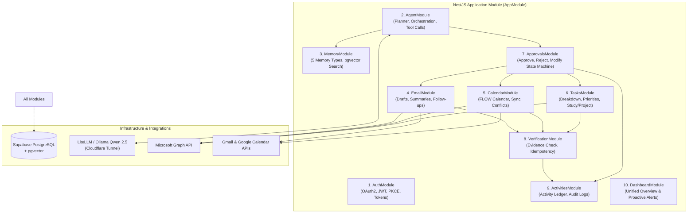
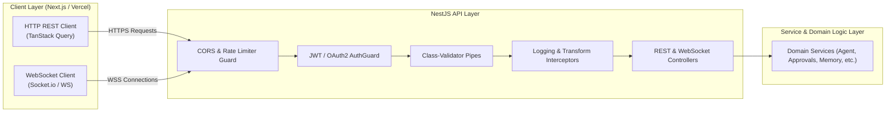
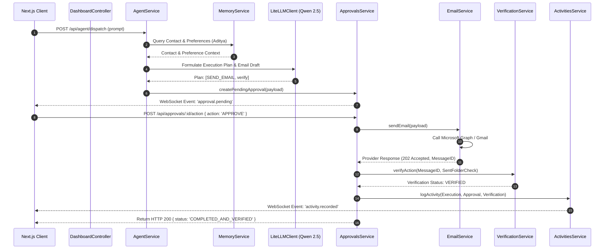

# FLOW — Backend Setup & API Specifications

**Version:** 1.0  
**Document Type:** Backend Architecture & API Specification  
**Status:** Approved Architecture  
**Runtime:** Node.js 20+ / NestJS  
**Deployment Platform:** Render  

---

## 1. Overview

The FLOW backend is an enterprise-structured, modular API service built using **NestJS** and **TypeScript**, deployed on **Render**. It orchestrates the core agent reasoning pipelines, manages the Human-in-the-Loop approval workflows, executes verified mutations across external APIs (Microsoft Graph, Gmail, Google Calendar), and persists data in **Supabase (PostgreSQL + pgvector)**.

---

## 2. Backend Module Architecture

The backend implements the 10 major modules mandated by the FLOW System Architecture Source of Truth.

### Backend Module Diagram

---

## 3. API Layer Architecture

The API layer manages client request ingress, authentication guards, input validation pipes, and real-time WebSocket events.

### API Layer Architecture Diagram

---

## 4. Service Communication Diagram

Illustrates the decoupled event-driven and procedural interactions between backend services during a coordinated productivity request.

### Service Communication Diagram

---

## 5. Comprehensive REST API Specifications

### 5.1 Authentication Module (`/api/auth`)
- `POST /api/auth/login/google` — Initiates Google OAuth2 PKCE flow.
- `GET /api/auth/callback/google` — Exchanges code for tokens and issues session JWT.
- `POST /api/auth/login/microsoft` — Initiates Microsoft 365 OAuth2 code flow.
- `GET /api/auth/callback/microsoft` — Exchanges code for Microsoft Graph tokens.
- `POST /api/auth/refresh` — Refreshes access tokens using stored refresh tokens.
- `GET /api/auth/me` — Returns current authenticated user profile and connected accounts.

### 5.2 Agent Module (`/api/agent`)
- `POST /api/agent/dispatch` — Accepts natural language prompt, resolves context, and initiates planning.
- `GET /api/agent/plans/:id` — Retrieves status, reasoning chain, and execution steps of a plan.
- `POST /api/agent/plans/:id/cancel` — Cancels an in-progress plan.
- `GET /api/agent/history` — Returns recent conversational interactions.

### 5.3 Memory Module (`/api/memory`)
- `GET /api/memory/contacts` — Lists stored contacts and associated roles.
- `POST /api/memory/contacts` — Creates or updates contact memory.
- `GET /api/memory/relationships` — Returns relationship mappings (e.g., co-lead, mentor).
- `GET /api/memory/preferences` — Returns user scheduling and communication preferences.
- `PUT /api/memory/preferences` — Updates preference attributes.
- `GET /api/memory/events` — Lists personal milestones, birthdays, anniversaries, and exams.
- `POST /api/memory/search-vector` — Performs pgvector cosine similarity search over behavioral memories.

### 5.4 Email Module (`/api/email`)
- `GET /api/email/inbox` — Fetches unified email feed from connected Microsoft Graph and Gmail accounts.
- `POST /api/email/draft` — Uses AI to compose an email draft from prompt instructions.
- `POST /api/email/send` — Triggers email dispatch (requires valid approval token).
- `POST /api/email/summarize` — Generates bullet-point summaries of an email thread.
- `POST /api/email/convert-to-task` — Extracts action items and deadline from an email into a task.
- `GET /api/email/follow-ups` — Returns sent emails awaiting responses past configured threshold.

### 5.5 Calendar Module (`/api/calendar`)
- `GET /api/calendar/events` — Fetches unified events from FLOW calendar and external sync providers.
- `POST /api/calendar/events` — Creates a new calendar event (approval gated for meetings with attendees).
- `PUT /api/calendar/events/:id/reschedule` — Reschedules an event with conflict check.
- `GET /api/calendar/conflicts` — Detects and returns overlapping events and task blocks.
- `POST /api/calendar/focus-blocks` — Generates focus blocks in available free slots.

### 5.6 Task Management Module (`/api/tasks`)
- `GET /api/tasks` — Lists tasks filterable by category (Quick, Project, Study, Event).
- `POST /api/tasks` — Creates a new task.
- `POST /api/tasks/breakdown` — Breaks a complex objective into subtasks using LiteLLM/Qwen 2.5.
- `POST /api/tasks/prioritize` — Recalculates priority scores across all active tasks.
- `PUT /api/tasks/:id/schedule` — Assigns a task to a dedicated calendar slot.
- `PATCH /api/tasks/:id/status` — Updates status (`PENDING`, `IN_PROGRESS`, `COMPLETED`).

### 5.7 Approval Center Module (`/api/approvals`)
- `GET /api/approvals/pending` — Returns all actions awaiting human review.
- `POST /api/approvals/:id/approve` — Confirms execution of the proposed action as-is.
- `POST /api/approvals/:id/reject` — Rejects the proposed action and terminates the plan.
- `POST /api/approvals/:id/modify` — Submits modified payload attributes and approves the revised action.

### 5.8 Verification Module (`/api/verification`)
- `GET /api/verification/receipts/:actionId` — Returns cryptographic proof, external resource ID, and verification status.
- `POST /api/verification/verify-manual` — Forces a re-verification check against external APIs.

### 5.9 Activities Module (`/api/activities`)
- `GET /api/activities/ledger` — Returns chronological, immutable ledger of all system actions.
- `GET /api/activities/export` — Exports audit trail for compliance and hackathon judges review.

### 5.10 Dashboard Module (`/api/dashboard`)
- `GET /api/dashboard/summary` — Aggregates pending approvals, upcoming events, priority tasks, and urgent emails into a single fast payload.
- `GET /api/dashboard/proactive-alerts` — Returns deadline risks, missing replies, and schedule health alerts.
