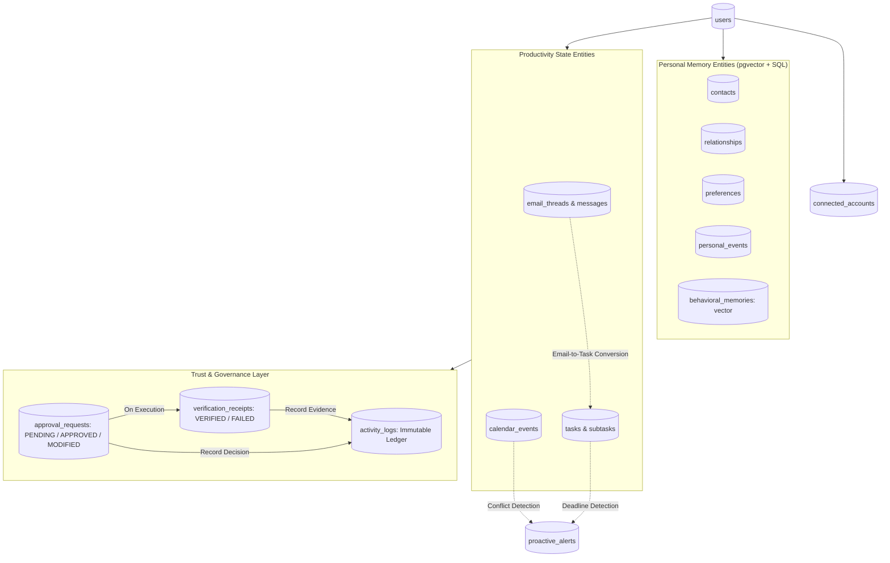

# FLOW — Database Schema & Data Models

**Version:** 1.0  
**Document Type:** Database Design & Entity Specification  
**Status:** Approved Architecture  
**Database Engine:** PostgreSQL 15+ (Hosted on Supabase)  
**Extensions:** `uuid-ossp`, `pgvector` (Vector Embeddings)  

---

## 1. Overview

The FLOW persistence layer is powered by **Supabase PostgreSQL** augmented with the **pgvector** extension. The schema is designed around strict relational integrity, immutable audit ledgers, idempotency enforcement, and vector similarity search for semantic memory retrieval.

---

## 2. Entity Relationship Diagram (ERD)

### ER Diagram

```mermaid
erDiagram
    USERS ||--o{ CONNECTED_ACCOUNTS : has
    USERS ||--o{ CONTACTS : knows
    USERS ||--o{ RELATIONSHIPS : defines
    USERS ||--o{ PREFERENCES : configures
    USERS ||--o{ PERSONAL_EVENTS : tracks
    USERS ||--o{ BEHAVIORAL_MEMORIES : exhibits
    USERS ||--o{ TASKS : owns
    USERS ||--o{ CALENDAR_EVENTS : schedules
    USERS ||--o{ EMAIL_THREADS : receives
    USERS ||--o{ APPROVAL_REQUESTS : reviews
    USERS ||--o{ ACTIVITY_LOGS : generates
    USERS ||--o{ PROACTIVE_ALERTS : receives

    TASKS ||--o{ SUBTASKS : contains
    APPROVAL_REQUESTS ||--o| VERIFICATION_RECEIPTS : verifies
    APPROVAL_REQUESTS ||--o{ ACTIVITY_LOGS : records

    USERS {
        uuid id PK
        string email UK
        string full_name
        timestamp created_at
        timestamp updated_at
    }

    CONNECTED_ACCOUNTS {
        uuid id PK
        uuid user_id FK
        string provider
        string account_email
        text access_token_enc
        text refresh_token_enc
        timestamp expires_at
    }

    CONTACTS {
        uuid id PK
        uuid user_id FK
        string name
        string email
        string role
        text notes
    }

    RELATIONSHIPS {
        uuid id PK
        uuid user_id FK
        uuid contact_id FK
        string relation_type
        int closeness_score
    }

    PREFERENCES {
        uuid id PK
        uuid user_id FK
        time work_start
        time work_end
        int max_daily_meetings
        int meeting_buffer_minutes
        string communication_tone
    }

    PERSONAL_EVENTS {
        uuid id PK
        uuid user_id FK
        string title
        string category
        date event_date
        boolean recurring
    }

    BEHAVIORAL_MEMORIES {
        uuid id PK
        uuid user_id FK
        text observation
        vector embedding
        float confidence
        timestamp observed_at
    }

    TASKS {
        uuid id PK
        uuid user_id FK
        string title
        string task_type
        string priority
        timestamp due_date
        timestamp scheduled_slot_start
        timestamp scheduled_slot_end
        string status
        uuid source_email_id
    }

    CALENDAR_EVENTS {
        uuid id PK
        uuid user_id FK
        string title
        timestamp start_time
        timestamp end_time
        boolean is_focus_block
        string external_provider
        string external_event_id
        string sync_status
    }

    EMAIL_THREADS {
        uuid id PK
        uuid user_id FK
        string external_thread_id
        string subject
        text summary
        boolean awaiting_reply
        timestamp last_message_at
    }

    APPROVAL_REQUESTS {
        uuid id PK
        uuid user_id FK
        string action_type
        jsonb proposed_payload
        jsonb modified_payload
        string status
        string idempotency_key UK
        timestamp reviewed_at
    }

    VERIFICATION_RECEIPTS {
        uuid id PK
        uuid approval_id FK
        string status
        string external_resource_id
        string proof_hash
        jsonb verification_evidence
        timestamp verified_at
    }

    ACTIVITY_LOGS {
        uuid id PK
        uuid user_id FK
        string log_type
        string action_name
        jsonb details
        timestamp created_at
    }

    PROACTIVE_ALERTS {
        uuid id PK
        uuid user_id FK
        string alert_type
        string severity
        text message
        boolean dismissed
        timestamp created_at
    }
```



---

## 3. Entity Relationship Flow

Illustrates how entities relate and flow across lifecycle transitions from prompt to verified record.

### Entity Relationship Flow Diagram



---

## 4. Detailed Table Definitions & SQL Schemas

### 4.1 Users & Authentication

```sql
CREATE EXTENSION IF NOT EXISTS "uuid-ossp";
CREATE EXTENSION IF NOT EXISTS "vector";

CREATE TABLE users (
    id UUID PRIMARY KEY DEFAULT uuid_generate_v4(),
    email VARCHAR(255) UNIQUE NOT NULL,
    full_name VARCHAR(255) NOT NULL,
    avatar_url TEXT,
    created_at TIMESTAMPTZ DEFAULT NOW(),
    updated_at TIMESTAMPTZ DEFAULT NOW()
);

CREATE TABLE connected_accounts (
    id UUID PRIMARY KEY DEFAULT uuid_generate_v4(),
    user_id UUID NOT NULL REFERENCES users(id) ON DELETE CASCADE,
    provider VARCHAR(50) NOT NULL, -- 'google' or 'microsoft'
    account_email VARCHAR(255) NOT NULL,
    access_token_enc TEXT NOT NULL,
    refresh_token_enc TEXT NOT NULL,
    token_expires_at TIMESTAMPTZ NOT NULL,
    scopes TEXT[] NOT NULL,
    created_at TIMESTAMPTZ DEFAULT NOW(),
    updated_at TIMESTAMPTZ DEFAULT NOW(),
    UNIQUE(user_id, provider, account_email)
);
```

### 4.2 Personal Memory Layer (With pgvector)

```sql
CREATE TABLE contacts (
    id UUID PRIMARY KEY DEFAULT uuid_generate_v4(),
    user_id UUID NOT NULL REFERENCES users(id) ON DELETE CASCADE,
    name VARCHAR(255) NOT NULL,
    email VARCHAR(255) NOT NULL,
    role VARCHAR(100),
    organization VARCHAR(150),
    notes TEXT,
    created_at TIMESTAMPTZ DEFAULT NOW(),
    updated_at TIMESTAMPTZ DEFAULT NOW()
);

CREATE TABLE relationships (
    id UUID PRIMARY KEY DEFAULT uuid_generate_v4(),
    user_id UUID NOT NULL REFERENCES users(id) ON DELETE CASCADE,
    contact_id UUID NOT NULL REFERENCES contacts(id) ON DELETE CASCADE,
    relation_type VARCHAR(100) NOT NULL, -- 'co-lead', 'client', 'mentor', 'peer'
    closeness_score INT DEFAULT 1,
    created_at TIMESTAMPTZ DEFAULT NOW()
);

CREATE TABLE preferences (
    id UUID PRIMARY KEY DEFAULT uuid_generate_v4(),
    user_id UUID UNIQUE NOT NULL REFERENCES users(id) ON DELETE CASCADE,
    work_start_time TIME DEFAULT '09:00:00',
    work_end_time TIME DEFAULT '18:00:00',
    max_daily_meetings INT DEFAULT 4,
    meeting_buffer_minutes INT DEFAULT 15,
    communication_tone VARCHAR(50) DEFAULT 'friendly_formal',
    updated_at TIMESTAMPTZ DEFAULT NOW()
);

CREATE TABLE personal_events (
    id UUID PRIMARY KEY DEFAULT uuid_generate_v4(),
    user_id UUID NOT NULL REFERENCES users(id) ON DELETE CASCADE,
    title VARCHAR(255) NOT NULL,
    category VARCHAR(50) NOT NULL, -- 'birthday', 'anniversary', 'exam', 'deadline'
    event_date DATE NOT NULL,
    recurring BOOLEAN DEFAULT FALSE,
    created_at TIMESTAMPTZ DEFAULT NOW()
);

CREATE TABLE behavioral_memories (
    id UUID PRIMARY KEY DEFAULT uuid_generate_v4(),
    user_id UUID NOT NULL REFERENCES users(id) ON DELETE CASCADE,
    observation TEXT NOT NULL,
    embedding VECTOR(1536), -- Vector embedding for similarity retrieval
    confidence FLOAT DEFAULT 1.0,
    observed_at TIMESTAMPTZ DEFAULT NOW()
);

CREATE INDEX idx_behavioral_embedding ON behavioral_memories USING ivfflat (embedding vector_cosine_ops);
```

### 4.3 Tasks & Projects

```sql
CREATE TABLE tasks (
    id UUID PRIMARY KEY DEFAULT uuid_generate_v4(),
    user_id UUID NOT NULL REFERENCES users(id) ON DELETE CASCADE,
    title VARCHAR(255) NOT NULL,
    description TEXT,
    task_type VARCHAR(50) NOT NULL DEFAULT 'quick', -- 'quick', 'project', 'study_plan', 'event_task'
    priority VARCHAR(20) DEFAULT 'medium', -- 'low', 'medium', 'high', 'urgent'
    due_date TIMESTAMPTZ,
    scheduled_slot_start TIMESTAMPTZ,
    scheduled_slot_end TIMESTAMPTZ,
    status VARCHAR(50) DEFAULT 'pending', -- 'pending', 'in_progress', 'completed', 'archived'
    source_email_id VARCHAR(255),
    created_at TIMESTAMPTZ DEFAULT NOW(),
    updated_at TIMESTAMPTZ DEFAULT NOW()
);

CREATE TABLE subtasks (
    id UUID PRIMARY KEY DEFAULT uuid_generate_v4(),
    task_id UUID NOT NULL REFERENCES tasks(id) ON DELETE CASCADE,
    title VARCHAR(255) NOT NULL,
    completed BOOLEAN DEFAULT FALSE,
    order_index INT DEFAULT 0
);
```

### 4.4 Calendar Events & Focus Blocks

```sql
CREATE TABLE calendar_events (
    id UUID PRIMARY KEY DEFAULT uuid_generate_v4(),
    user_id UUID NOT NULL REFERENCES users(id) ON DELETE CASCADE,
    title VARCHAR(255) NOT NULL,
    description TEXT,
    start_time TIMESTAMPTZ NOT NULL,
    end_time TIMESTAMPTZ NOT NULL,
    is_focus_block BOOLEAN DEFAULT FALSE,
    external_provider VARCHAR(50), -- 'microsoft' or 'google' or null (FLOW native)
    external_event_id VARCHAR(255),
    sync_status VARCHAR(50) DEFAULT 'in_sync',
    created_at TIMESTAMPTZ DEFAULT NOW(),
    updated_at TIMESTAMPTZ DEFAULT NOW()
);
```

### 4.5 Approvals, Verification & Activity Ledger

```sql
CREATE TABLE approval_requests (
    id UUID PRIMARY KEY DEFAULT uuid_generate_v4(),
    user_id UUID NOT NULL REFERENCES users(id) ON DELETE CASCADE,
    action_type VARCHAR(100) NOT NULL, -- 'SEND_EMAIL', 'CREATE_EVENT', 'RESCHEDULE_EVENT', 'DELETE_TASK'
    target_service VARCHAR(50) NOT NULL, -- 'microsoft_graph', 'gmail', 'google_calendar'
    proposed_payload JSONB NOT NULL,
    modified_payload JSONB,
    status VARCHAR(50) NOT NULL DEFAULT 'PENDING', -- 'PENDING', 'APPROVED', 'MODIFIED', 'REJECTED'
    idempotency_key VARCHAR(255) UNIQUE NOT NULL,
    created_at TIMESTAMPTZ DEFAULT NOW(),
    reviewed_at TIMESTAMPTZ
);

CREATE TABLE verification_receipts (
    id UUID PRIMARY KEY DEFAULT uuid_generate_v4(),
    approval_id UUID UNIQUE NOT NULL REFERENCES approval_requests(id) ON DELETE CASCADE,
    status VARCHAR(50) NOT NULL, -- 'VERIFIED', 'VERIFICATION_FAILED'
    external_resource_id VARCHAR(255),
    proof_hash VARCHAR(255) NOT NULL,
    verification_evidence JSONB NOT NULL,
    verified_at TIMESTAMPTZ DEFAULT NOW()
);

CREATE TABLE activity_logs (
    id UUID PRIMARY KEY DEFAULT uuid_generate_v4(),
    user_id UUID NOT NULL REFERENCES users(id) ON DELETE CASCADE,
    log_type VARCHAR(50) NOT NULL, -- 'EXECUTION', 'APPROVAL', 'VERIFICATION'
    action_name VARCHAR(100) NOT NULL,
    details JSONB NOT NULL,
    created_at TIMESTAMPTZ DEFAULT NOW()
);

CREATE TABLE proactive_alerts (
    id UUID PRIMARY KEY DEFAULT uuid_generate_v4(),
    user_id UUID NOT NULL REFERENCES users(id) ON DELETE CASCADE,
    alert_type VARCHAR(50) NOT NULL, -- 'DEADLINE_RISK', 'MISSING_REPLY', 'SCHEDULE_CONFLICT', 'HEALTH_ALERT'
    severity VARCHAR(20) DEFAULT 'warning', -- 'info', 'warning', 'critical'
    message TEXT NOT NULL,
    dismissed BOOLEAN DEFAULT FALSE,
    created_at TIMESTAMPTZ DEFAULT NOW()
);
```
