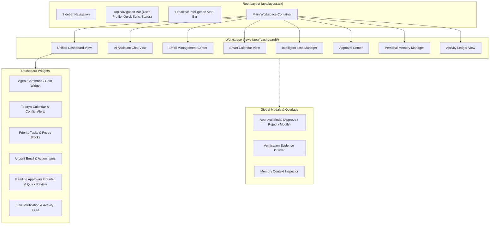
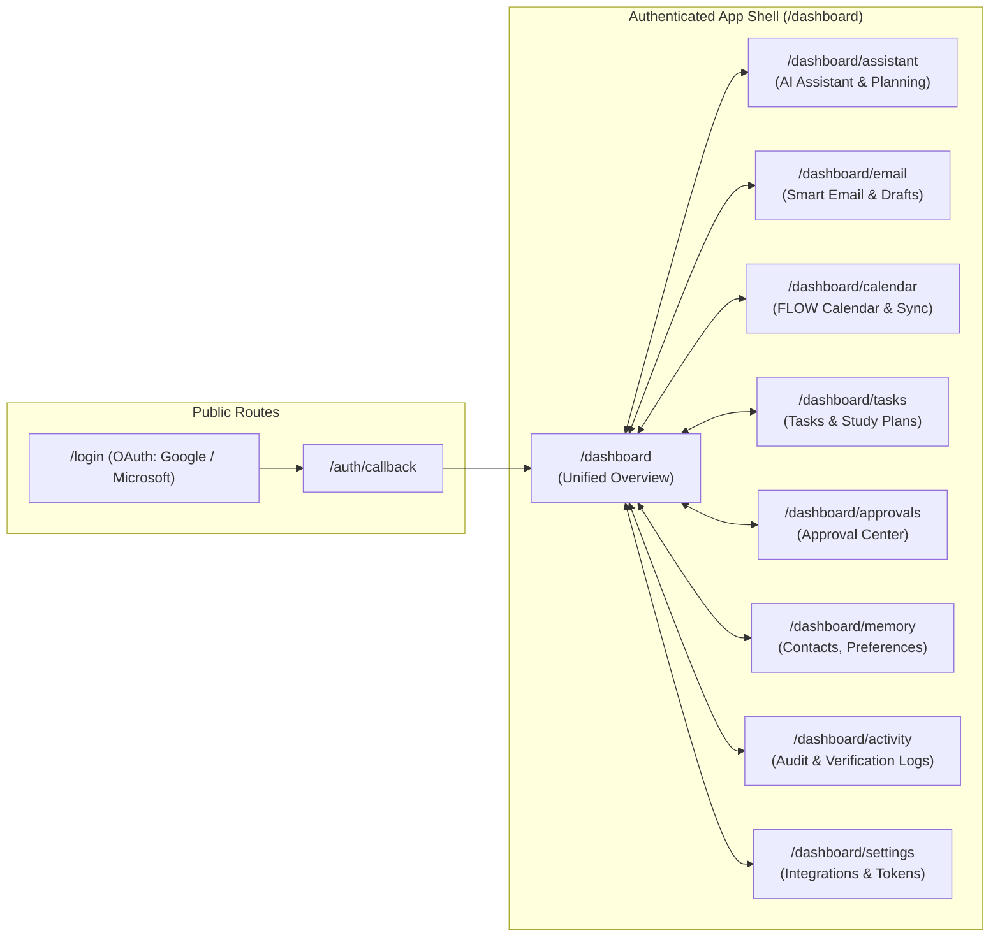

# FLOW — Frontend & Dashboard Specification

**Version:** 1.0  
**Document Type:** Frontend Architecture & UI Specification  
**Status:** Approved Architecture  
**Deployment Platform:** Vercel  

---

## 1. Overview

The FLOW frontend is a responsive, high-performance web application built with **Next.js**, **React**, **Tailwind CSS**, and **Shadcn UI**, deployed on **Vercel**. It serves as the primary visual and conversational workspace for the FLOW Agentic AI Personal Productivity Operating System.

The frontend is designed around FLOW's core principles:
- **Human Approval Required:** Consequential actions are intercepted and presented with clear options to Approve, Reject, or Modify.
- **Verification Before Success:** Live status indicators confirm when an external action has been verified by the backend.
- **Activity Logging:** Real-time stream of audit records and execution proofs.
- **Explainable Actions:** Dedicated reasoning cards explain why actions were planned and what context was retrieved.
- **Persistent User Memory:** Intuitive memory managers for contacts, relationships, preferences, events, and behavioral patterns.

---

## 2. Technology Stack

- **Framework:** Next.js (App Router, Server & Client Components)
- **Library:** React 18+ / TypeScript
- **Styling:** Tailwind CSS
- **Component Primitives:** Shadcn UI (Radix UI primitives)
- **Icons:** Lucide React
- **State Management:** TanStack Query (React Query) for server state, Zustand for UI client state
- **Real-Time Communication:** WebSockets / Server-Sent Events (SSE) for agent execution streaming and live verification updates
- **Deployment:** Vercel Edge & Serverless platform

---

## 3. Dashboard Component Structure

The dashboard interface integrates nine core modules into a cohesive single-pane productivity environment.

### Dashboard Component Hierarchy Diagram

---

## 4. Frontend Navigation Architecture

### Frontend Navigation Diagram

---

## 5. Core Module UI Specifications

### 5.1 AI Assistant Interface
- **Natural Language Input:** Command bar supporting voice or text inputs with multi-line expandability.
- **Plan Preview Card:** Collapsible accordion displaying planned execution steps before execution.
- **Context Drawer:** Displays active memory entities (e.g., resolved contacts, relevant preferences) used for plan formulation.
- **Streaming Execution Status:** Visual step indicator (Planning → Awaiting Approval → Executing → Verifying → Complete).

### 5.2 Smart Email Management View
- **Unified Mailbox:** Displays threads from connected accounts (Microsoft 365 and Gmail).
- **AI Email Composer:** Natural language prompt input to generate formatted email drafts.
- **Email-to-Task Conversion:** One-click conversion button on email messages to create structured tasks with auto-detected deadlines.
- **Follow-Up Detection Badge:** Highlights sent emails lacking replies past configured threshold days.

### 5.3 Smart Calendar View
- **FLOW Independent Calendar:** Native grid supporting day, week, and month views.
- **External Sync Indicators:** Visual badges for events synced with Microsoft Graph or Google Calendar.
- **Conflict Visualizer:** Red warning badges and inline resolution popovers for overlapping commitments.
- **Focus Block Generator:** One-click insertion of deep work and study sessions into detected free blocks.

### 5.4 Intelligent Task Management View
- **Categorized Boards:** Tabbed views for Quick Tasks, Project Tasks, Study Plans, and Event Tasks.
- **AI Task Breakdown Modal:** Generates hierarchical subtasks and checklist items from high-level objectives.
- **Priority Scoring Badges:** Color-coded priority tags based on deadline proximity and importance scoring.
- **Smart Schedule Drag-and-Drop:** Ability to drag tasks directly onto calendar slots.

### 5.5 Approval Center
- **Action Approval Card:** Contains:
  - Action Category (Email, Calendar, Task)
  - Target Service (Microsoft Graph, Gmail, Google Calendar)
  - Detailed Action Payload / Proposed Diff
  - Justification and Source Memory Reference
- **Action Buttons:**
  - **Approve:** Green confirmation initiating backend execution.
  - **Reject:** Red rejection canceling the proposed action and notifying the agent.
  - **Modify:** Yellow trigger opening an inline editor to adjust email body, meeting time, or task deadline prior to approval.

### 5.6 Verification & Activity Ledger
- **Status Badges:** `PENDING_APPROVAL`, `APPROVED`, `EXECUTING`, `VERIFIED`, `FAILED`.
- **Proof Inspection Drawer:** Clickable drawer showing verification proof (external message ID, calendar event etag, verification timestamp).
- **Audit Filtering:** Filter by action type, verification status, and date range.

### 5.7 Personal Memory Manager
- **Contact Memory:** List and editor for recognized people, email addresses, and roles.
- **Relationship Memory:** Relationship graph viewer (e.g., "Aditya = Co-Lead", "Priya = Mentor").
- **Preference Memory:** Toggles and input fields for working hours, buffer times, and communication tone.
- **Event Memory:** Calendar of personal milestones, birthdays, anniversaries, and academic exams.
- **Behavioral Memory:** List of learned interaction patterns with reset and edit options.

### 5.8 Proactive Intelligence Bar
- Top-mounted persistent alert bar notifying the user of:
  - Critical deadline proximity (< 24 hours).
  - Unanswered important email threads.
  - Upcoming calendar conflicts.
  - Schedule health warnings (e.g., > 5 hours of back-to-back meetings without breaks).
