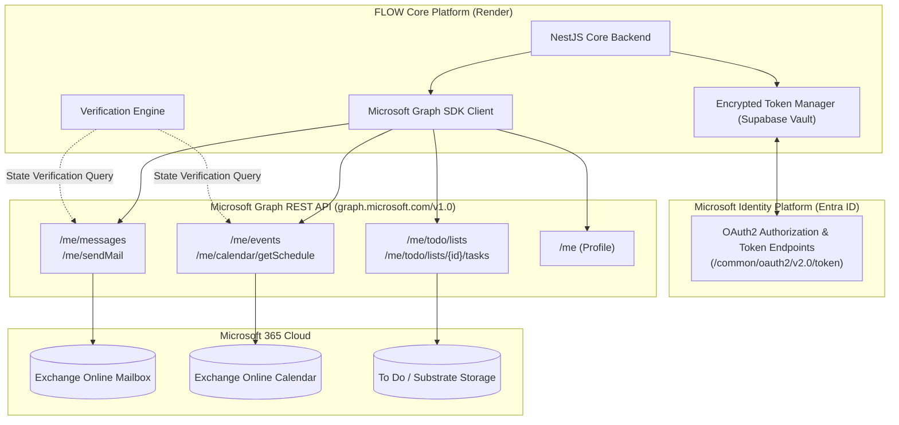
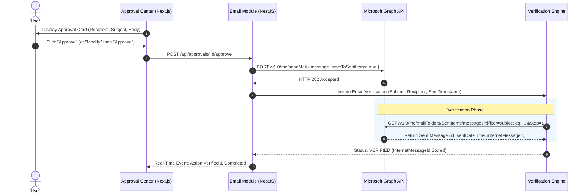
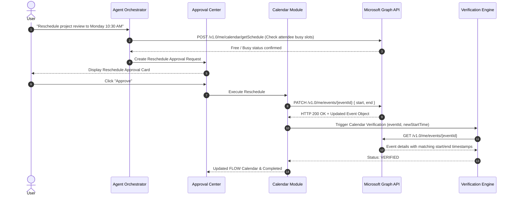

# FLOW — Microsoft Graph Integration Specification

**Version:** 1.0  
**Document Type:** External API Integration Specification  
**Status:** Approved Architecture  
**Provider:** Microsoft Graph REST API v1.0  

---

## 1. Overview

Microsoft Graph provides unified programmatic access to Microsoft 365 services. In FLOW, Microsoft Graph serves as an external synchronization provider and execution engine for:
- **Outlook Mail:** Reading threads, creating drafts, and sending approved messages.
- **Outlook Calendar:** Reading user schedules, detecting conflicts, synchronizing FLOW native calendar events, and updating meetings.
- **Microsoft To Do:** Reading task lists, creating synchronized tasks, and marking items complete.

FLOW maintains its own independent calendar and task models; Microsoft Graph is leveraged for external synchronization, automated execution, and state verification.

---

## 2. Integration Architecture

### Graph Integration Architecture Diagram



---

## 3. Email Execution Flow

All outgoing emails are planned by the Agent, authorized in the Approval Center (Approve / Reject / Modify), and executed via Microsoft Graph before being verified.

### Email Flow Diagram



---

## 4. Calendar Synchronization & Scheduling Flow

FLOW operates an independent calendar engine. When a meeting is scheduled or rescheduled, the event is written locally, pushed to Microsoft Graph, and verified.

### Calendar Flow Diagram



---

## 5. Verification Flow

To guarantee that actions are real and verifiable, FLOW executes structured checks against Graph endpoints before recording an action as complete.

### Verification Flow Diagram

```mermaid
flowchart TD
    StartVerif([Initiate Verification]) --> CheckType{Action Type}
    
    CheckType -->|Email Sent| VerifyMail[Query /me/mailFolders/SentItems/messages]
    CheckType -->|Event Created / Rescheduled| VerifyCal[Query /me/events/{id}]
    CheckType -->|Task Created / Completed| VerifyTask[Query /me/todo/lists/{id}/tasks/{id}]
    
    VerifyMail --> EvalMail{Sent message found with matching recipient?}
    VerifyCal --> EvalCal{Event exists with approved start/end times?}
    VerifyTask --> EvalTask{Task status matches approved mutation?}
    
    EvalMail -->|Yes| ConfirmSuccess[Generate SHA-256 Proof Hash & Mark VERIFIED]
    EvalCal -->|Yes| ConfirmSuccess
    EvalTask -->|Yes| ConfirmSuccess
    
    EvalMail -->|No| BackoffProbe{Retry Window Active? (up to 3 attempts)}
    EvalCal -->|No| BackoffProbe
    EvalTask -->|No| BackoffProbe
    
    BackoffProbe -->|Yes| SleepWait[Wait 1000ms] --> CheckType
    BackoffProbe -->|No| FlagFailed[Mark VERIFICATION_FAILED & Notify User in Alert Bar]
    
    ConfirmSuccess --> RecordLedger[Append Verification Record to Activity Ledger]
    FlagFailed --> RecordLedger
```

---

## 6. Microsoft Graph Permissions & Scopes

FLOW requests the minimum necessary OAuth2 scopes using incremental consent:
- `User.Read` — Read user profile and email.
- `Mail.ReadWrite` — Read mailbox messages and compose drafts.
- `Mail.Send` — Send approved emails.
- `Calendars.ReadWrite` — Read calendar schedules and create/modify events.
- `Tasks.ReadWrite` — Read and update Microsoft To Do tasks.
- `offline_access` — Maintain long-term access via refresh tokens.
