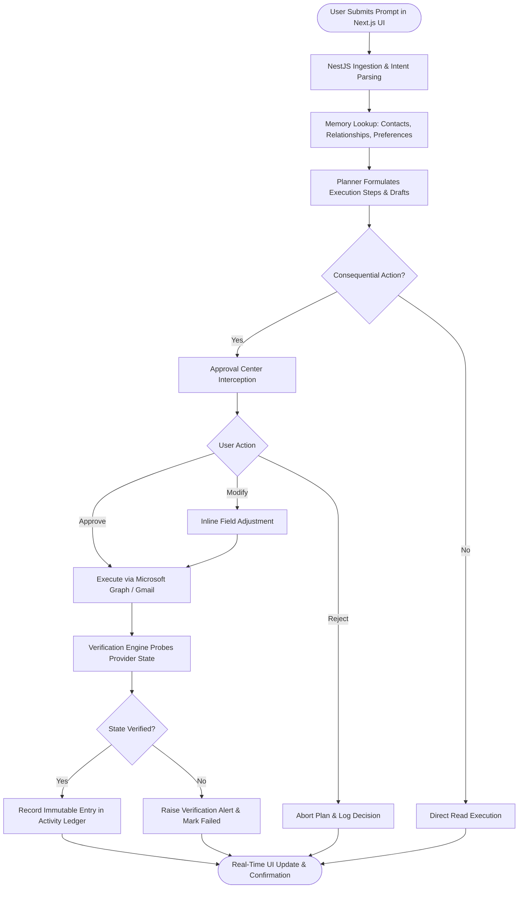
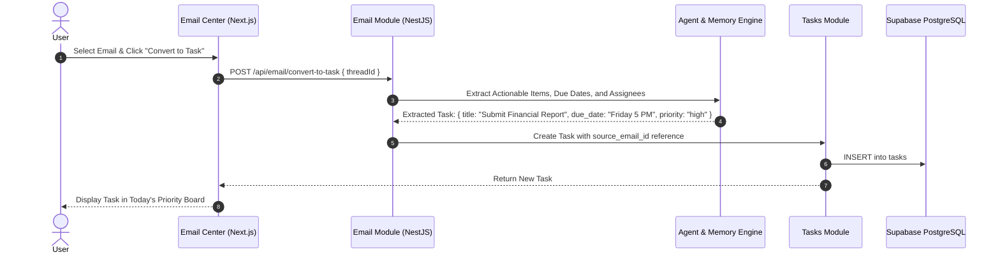
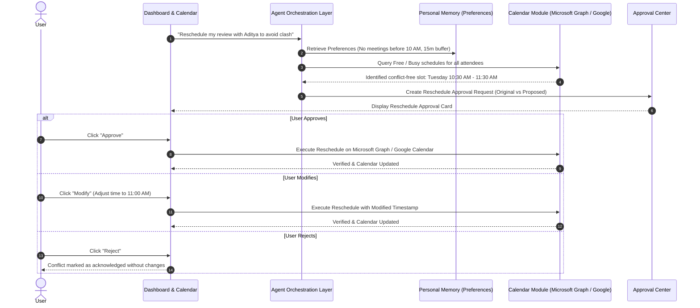
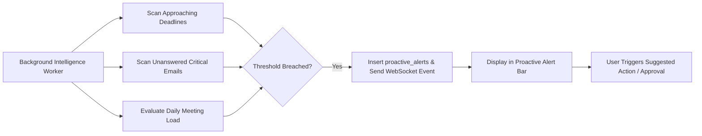

# FLOW — Core User Flows

**Version:** 1.0  
**Document Type:** Product User Experience & Workflow Specification  
**Status:** Approved  
**Product Category:** Agentic AI Personal Productivity Operating System  

---

## 1. Overview

This document specifies the primary user journeys and operational flows in FLOW. Every flow adheres to FLOW's core principles:
- Understand before acting
- Human approval required (Approve, Reject, Modify)
- State verification before marking actions complete
- Transparent activity logging
- Retry-safe execution

---

## 2. Primary End-to-End User Journey

### High-Level User Journey Diagram

---

## 3. Email-to-Task Conversion Flow

Users can convert action items mentioned in emails into structured tasks with auto-detected deadlines and priority scores.

---

## 4. Smart Meeting Rescheduling & Conflict Resolution Flow

When a meeting conflict arises, FLOW detects it, computes an alternative slot honoring working hours and buffer preferences, and requests user approval.

---

## 5. Proactive Alerting & Health Analysis Flow

FLOW continuously analyzes schedule density, overdue responses, and deadline risks in the background.

